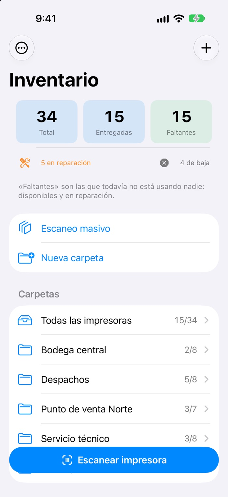
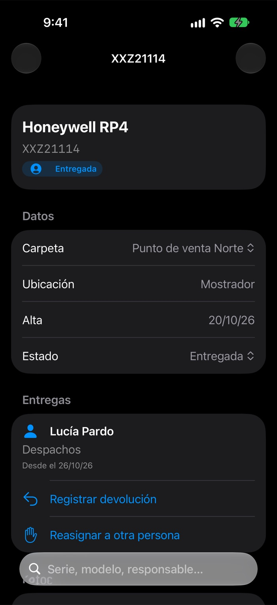

# 📱 Inventario de impresoras — App iOS con escaneo de códigos

**Escanea el número de serie y sabe al instante dónde está cada impresora y quién la tiene**

[🌐 Ver portafolio](https://azixtechnologyco-rgb.github.io/#impresoras)

  
  &nbsp;&nbsp;
  

## El problema

Un parque de impresoras portátiles se repartía entre áreas y personas sin control: no se sabía cuáles
estaban disponibles, cuáles en reparación ni quién tenía cada una.

## La solución

- **Escaneo individual y masivo** de códigos de barras y QR con la cámara.
- Resumen al abrir: total, entregadas, faltantes, en reparación y de baja.
- **Entregas y devoluciones** con responsable, área e historial completo por equipo.
- Carpetas por ubicación, fotos de cada impresora e importación y exportación en CSV.
- **Funciona sin conexión**, con persistencia local, y tiene pruebas de interfaz automatizadas.
- Versión **web en Flutter** con backend propio (Kotlin + Spring Boot + MongoDB) y exportación a PDF y CSV.

## Stack

| App iOS | Versión web |
|---|---|
| Swift · SwiftUI · SwiftData · AVFoundation · XCTest UI | Flutter Web · Dart · Provider · Kotlin + Spring Boot · MongoDB |

---

> 🔒 El código fuente es privado. Las capturas usan **datos de ejemplo**.
>
> Desarrollado por **[Azix Technology](https://azixtechnologyco-rgb.github.io)** · Isaac Ávila
